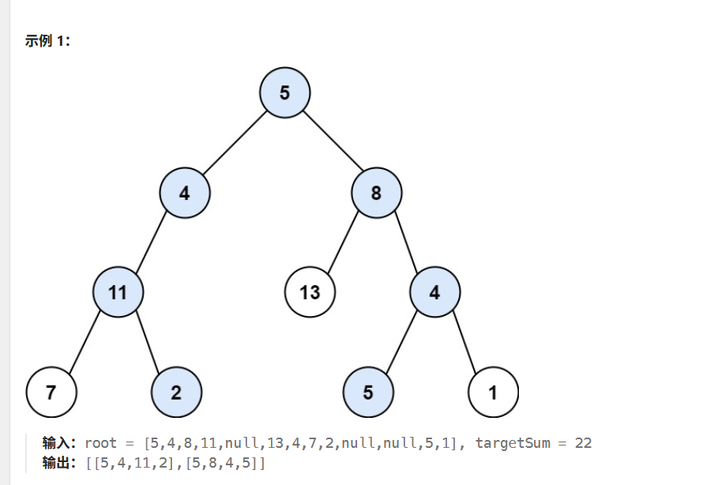
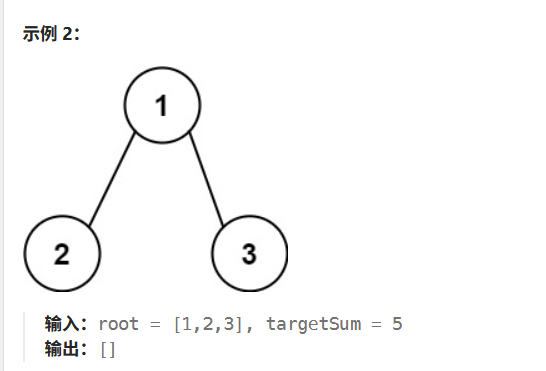

# 【算法名称】

【路径总和II】

https://leetcode.cn/problems/path-sum-ii/

给你二叉树的根节点 root 和一个整数目标和 targetSum ，找出所有 从根节点到叶子节点 路径总和等于给定目标和的路径。

叶子节点 是指没有子节点的节点。




## 【输入输出】


```text
输入：root = [5,4,8,11,null,13,4,7,2,null,null,5,1], targetSum = 22
输出：[[5,4,11,2],[5,8,4,5]]

输入：root = [1,2,3], targetSum = 5
输出：[]
```

## 【思路】

1. 树的递归本质上有点像回溯，遍历每一个可以到达的节点，不过有一个点需要注意：每一个节点进去，只判断到该节点的和是否满足条件，在该节点时不考虑子节点！！！

2. List<Integer> part类对象本质上是一个引用对象，所以dfs的过程中如果全部使用同一个引用对象，记得将元素remove掉。

3. 最终添加的时候也需要添加一个new ArrayList<>(part)，这个对象是一个新的地址，不会引用到part。
