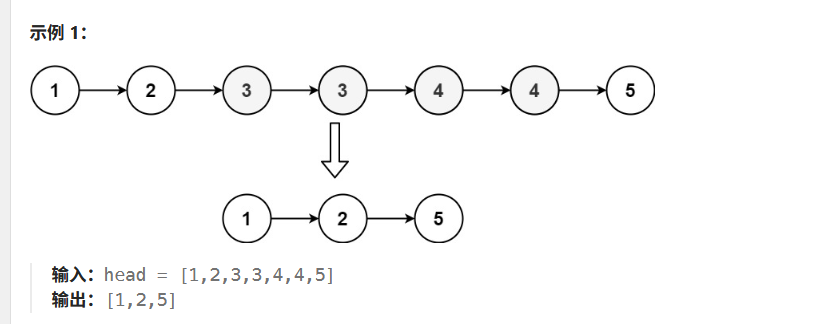

# 【算法名称】

【删除排序链表中的重复元素I II】

https://leetcode.cn/problems/remove-duplicates-from-sorted-list/

https://leetcode.cn/problems/remove-duplicates-from-sorted-list-ii/

## 【输入输出】


```text
输入：head = [1,2,3,3,4,4,5]
输出：[1,2,5]


```

## 【思路】

1. 这两道题很像，一个是保留一个重复的元素节点；另一个是一个重复的元素节点都不保留。现在来分别说一下这两类问题如何处理

2. 只保留一个元素节点：pre.next.val == pre.next.next.val，如果相等的话跳过一个重复的元素；当遇到不相等话，那本身这个元素就会保留，而且保留的是重复元素里面index靠后的那个

3. 如果一个重复元素节点都不保留的话：获取当前重复节点的元素值，通过该val挨个和节点比较，不再是前后进行比较。这样重复的元素节点一个都不会保留
