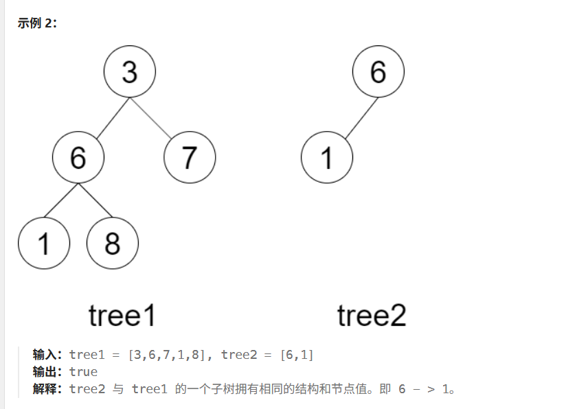

# 【算法名称】

## 【子结构判断】

https://leetcode.cn/problems/shu-de-zi-jie-gou-lcof/description/

给定两棵二叉树 tree1 和 tree2，判断 tree2 是否以 tree1 的某个节点为根的子树具有 相同的结构和节点值 。
注意，空树 不会是以 tree1 的某个节点为根的子树具有 相同的结构和节点值 。



## 【输入输出】


```text
输入：tree1 = [3,6,7,1,8], tree2 = [6,1]
输出：true
解释：tree2 与 tree1 的一个子树拥有相同的结构和节点值。即 6 - > 1。
```

## 【思路】

1. 从tree1的头结点开始判断，如果和tree2的头结点值相同的话，就继续判断左右子树是否也相同，如果在遍历的过程中，tree2的节点先为null，说明出现了子结构；如果tree1的节点先为null，说明不存在完全相等的子结构。

2. 如果tree1的头结点不相等的话，那就要判断tree1头结点的左右节点和tree2的头结点是否相同，然后继续重复1的操作

3. ```java
    return match(A,B) || isSubStructure(A.left,B) || isSubStructure(A.right,B); // isSubStructure是主函数，match是用于匹配子结构是否相同的辅助函数
```
